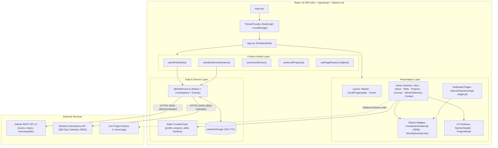
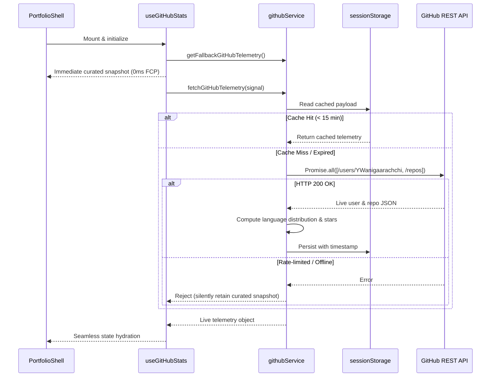

# Portfolio System Architecture

This document describes the frontend architecture, layering strategy, data flow, caching model, and deployment setup for **Yasas Wanigaarachchi's React Engineering Portfolio** (`YWanigaarachchi`).

---

## 1. Architectural Principles

- **Clean Separation of Concerns (Layered Modular Frontend)**: Domain types, static curated content, external API services, stateful custom hooks, reusable UI primitives, and page sections are strictly decoupled.
- **Resilient Hybrid Data Strategy**: Curated portfolio metadata (`src/data/`) loads instantaneously with zero layout shift, while live GitHub telemetry (`src/services/githubService.ts`) hydrates asynchronously with `sessionStorage` caching (15-minute TTL) and automatic graceful fallback if offline or rate-limited.
- **Type-Safe Domain Modeling**: Strict TypeScript (`strict: true`, `noUnusedLocals`, `noUnusedParameters`) with `@/` path aliases.
- **Performance-First Bundling**: Vite 6 with manual Rollup chunk splitting (`vendor`, `motion`, `icons`) for optimal browser caching.

---

## 2. High-Level System Architecture



---

## 3. Folder Structure & Module Responsibilities

```text
Yasas-Wanigaarachchi/
├── index.html                          # Entry HTML, Google Fonts & SEO meta tags
├── vite.config.ts                      # Vite + React + Tailwind v4 + chunk splitting
├── tsconfig*.json                      # Strict TypeScript project references
├── ARCHITECTURE.md                     # This architecture specification
├── public/
│   └── favicon.svg                     # Custom YW monogram vector icon
└── src/
    ├── main.tsx                        # React 19 root mount
    ├── styles/
    │   └── index.css                   # Tailwind v4 tokens, dark variant & grid backdrop
    ├── config/
    │   └── site.ts                     # Central constants (GitHub handle, cache TTL, nav)
    ├── types/
    │   └── portfolio.ts                # Core domain TypeScript interfaces
    ├── data/
    │   ├── profile.ts                  # Developer identity, specialties & social links
    │   ├── projects.ts                 # Featured & systems projects with architecture notes
    │   ├── skills.ts                   # Categorized engineering stack & proficiency tiers
    │   └── timeline.ts                 # Founder experience & Cardiff Met education
    ├── services/
    │   └── githubService.ts            # GitHub REST client + TTL cache + fallback factory
    ├── hooks/
    │   ├── useGitHubStats.ts           # Live repo & profile telemetry hook
    │   ├── useGitHubContributions.ts   # 365-day contributions & public events hook
    │   ├── usePageRoute.ts             # Hash-synced SPA routing (Home / #/github)
    │   ├── useActiveSection.ts         # IntersectionObserver scroll-spy for Navbar
    │   └── useScrollProgress.ts        # Passive scroll listener for progress bar
    ├── pages/
    │   └── GitHubTelemetryPage.tsx     # Dedicated Live Telemetry & Contributions Page
    ├── app/
    │   ├── App.tsx                     # Root composition shell & view switcher
    │   └── providers/
    │       └── ThemeProvider.tsx       # Persistent Dark/Light theme context
    └── components/
        ├── github/
        │   ├── ContributionHeatmap.tsx # 53-week x 7-day interactive contributions calendar
        │   └── MonthlyActivityChart.tsx # 12-month animated velocity bar chart
        ├── ui/
        │   ├── SectionHeader.tsx       # Standardized indexed section headings (01 // ...)
        │   └── ProjectModal.tsx        # Accessible architecture deep-dive modal
        ├── layout/
        │   ├── ScrollProgressBar.tsx   # Top scroll indicator
        │   ├── Navbar.tsx              # Sticky glassmorphic header + mobile drawer
        │   └── Footer.tsx              # Footer & back-to-top anchor
        └── sections/
            ├── HeroSection.tsx         # Identity hero + interactive TS code profile card
            ├── AboutSection.tsx        # 4 core engineering specialty pillars
            ├── SkillsSection.tsx       # Tab-filtered technical stack matrix
            ├── ProjectsSection.tsx     # Filterable showcase + Architecture modal trigger
            ├── JourneySection.tsx      # SoftgenixLK & Cardiff Met vertical timeline
            ├── GitHubTelemetrySection.tsx # Live KPI cards, language bar & repo feed
            └── ContactSection.tsx      # Direct links, copy email & mailto composer
```

---

## 4. Data Flow & Caching Sequence (GitHub Live Sync)



---

## 5. Deployment Architecture

Because the application compiles to a pure static bundle (`dist/`), it can be deployed with zero backend overhead on:

1. **Vercel (Recommended)**: Connect `YWanigaarachchi/Yasas-Wanigaarachchi` directly; Vite preset auto-detected (`npm run build` -> `dist/`).
2. **GitHub Pages**: Add a GitHub Actions workflow running `npm ci && npm run build` and publishing `dist/` to `gh-pages`.
3. **Cloudflare Pages / AWS S3 + CloudFront**: Upload `dist/` with immutable caching on `/assets/*`.
